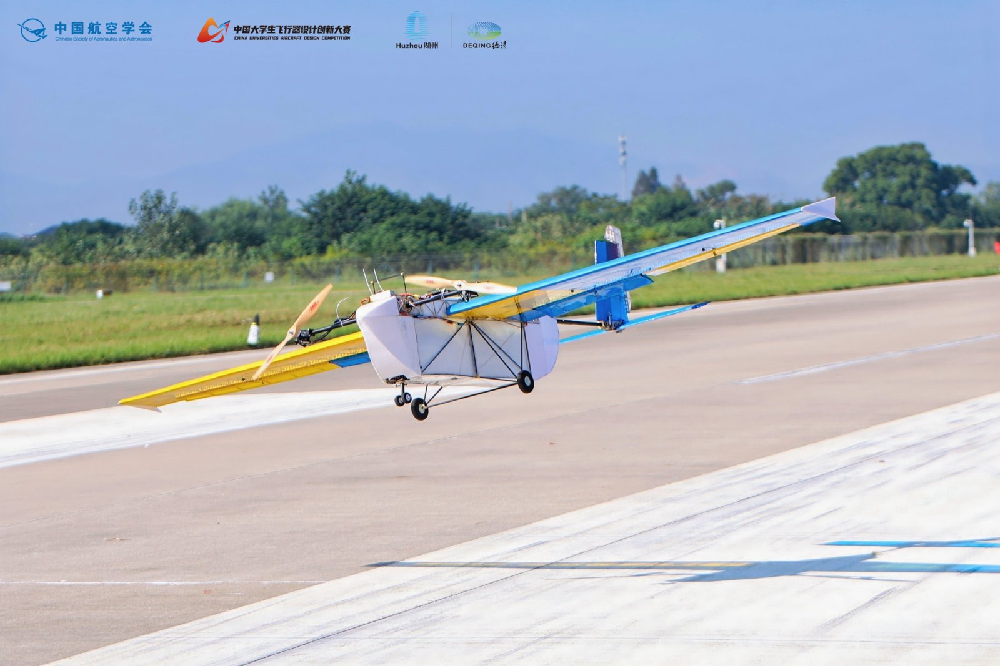
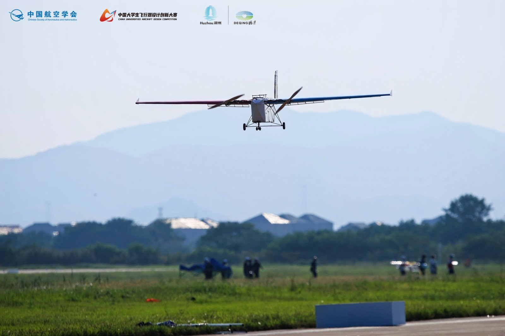

# 飞行器创新实验室

:::info

通常简称为**飞创**

:::

飞行器创新实验室成立于 2017 年，是宣城校区首个多学科交叉融合的实验室，以培养在程序设计与模型设计和动手能力强的创造型人才为目的。实验室曾获对地侦查与打击无人机项目全国冠军，机翼静载全国季军，安徽省电子设计竞赛无人机赛道第一名。

## 实验室简介

在刚刚结束的中国大学生飞行器设计创新大赛东部赛区中，宣城校区飞行器创新实验室荣获多个项目的一二三等奖，包括太阳能任务飞行、限时载运飞行、无人机短距起降，并成功入围全国总决赛。同时在暑假举行的安徽省大学生电子设计大赛中，实验室获得二等奖、三等奖共八项，成绩优异。

### 地点

计算机中心楼 `302B`、`310`、`311`

### 可以学到的知识

经过 5 年的积累，实验室有着大量飞行器资料与飞行器模型制作经验

- C 语言控制程序的编写
- 单片机与嵌入式开发
- 目标识别
- 3D 建模打印
- 材料制图
- 机械模型设计等

### 实验室设备

- 大功率激光切割机一台
- 3D 打印机一台
- 四旋翼飞行器若干
- 大型及小型固定翼无人机若干

### 参加的竞赛

- 中国大学生飞行器设计创新大赛
- 全国大学生电子设计竞赛
- 安徽省机器人大赛
- 大创
- 互联网+（大创赛）
- 挑战杯
- ican

### 已有作品

- 对地侦察与打击无人机
- 创新载重无人机
- 空地协同智能消防系统
- 基于激光雷达和 ROS 的无人机地图构建和导航系统等。

### 近年来获得的奖项有

- 2017 年 CADC 全国一等奖三项，二等奖两项。
- 2018 年 CADC 全国一等奖四项，二等奖两项，三等奖一项，其中对地侦查项目获全国单项冠军，学校获得优秀团体奖项。
- 2019 年 CADC 获得一等奖两项、二等奖四项，三等奖两项。
- 2020 年安徽省电子设计大赛一等奖一项，二等奖一项，其中一等奖为省内唯一满分作品；CADC 中获得二等奖一项，互联网＋省铜一项。
- 2021 年安徽省电子设计竞赛三等奖三项，互联网＋省赛金奖两项，申请国家级大创一项，校级大创若干。
- 2022 年国家级大创一项，省级大创两项，CUADC 二等奖两项、三等奖四项。
- 2023 年国家级大创一项，省级、校级大创若干；CUADC 全国总决赛分别获得三个项目的一等奖、二等奖、三等奖；东部赛区分别获得三个项目的第一名、第二名、第三名。
- 2024 年省级大创两项、校级大创若干；安徽省大学生电子设计大赛无人机赛道获一等奖一项、二等奖一项、三等奖两项；CUADC 东部赛区获三个项目的二等奖，CUADC 全国总决赛一等奖一项，二等奖一项，三等奖四项。
- 2025 年省级校级大创若干；安徽省电子设计创新大赛二等奖三项、三等奖五项；CUADC 东部赛区一等奖一项，二等奖一项，三等奖一项，并在 10 月份前往湖州德清参加全国总决赛。

欢迎新同学们加入我们飞创的大家庭！

## 招新组别

### 2025 级同学

仅招收掌握以下相关能力之一的大二同学，看到招新通知后可以直接联系管理员参加面试考核。

1. 对 51/32 单片机能够熟练掌握运用，且经过项目实践
2. 有固定翼飞行器设计能力和相关建模画图能力
3. 有手动飞行固定翼飞行器的经验，且能够熟练掌控

### 2026 级同学

大一新同学不论基础

1. **电控组**：可以学到的内容包括 c 语言程序编写、单片机与嵌入式开发、图像处理（目标识别等）、飞行器控制等。
2. **机械组**：可以学到的内容包括 SW、Catia 3D 建模、CAD 平面制图、XFLR5、Profili 等飞行器设计，ANSYS 软件分析。同时会直接运用到 3d 打印、激光切割、飞行器模型制作的实践中。

## 招新流程

### 报名

加入 2026 飞行器创新实验室招新群：[1108684404](https://qm.qq.com/q/Sz8zJtnLaw)

关注群内有关招新的信息（发布在线报名表后及时填写）

### 笔试考核

暂定于十月中旬进行第一轮笔试，具体时间地点待通知，笔试学习资料发布在群文件笔试考核内容：

- **电控组**：重点考察 c 语言部分，同时了解笔试学习资料 16-21 页的内容
- **机械组**：笔试学习资料 1-15 页

### 后续考核

笔试通过后开展数月的集中培训，每次培训都将计入考核，通过最终面试即可加入实验室。具体培训时间和内容后续会在群内公布。任何招新相关的其他问题都可以在招新群咨询。

## 了解更多

更多实验室日常训练视频可前往[哔哩哔哩](https://space.bilibili.com/678400296)、[抖音](https://www.douyin.com/user/MS4wLjABAAAAVPNXH4sMYV6H5d2bnB0DqFLlSL6Rz4lWZ7r9PBoGOIAiRReacQdUetU3y6KkA7lW)观看。

<iframe src="//player.bilibili.com/player.html?isOutside=true&aid=113038707394768&bvid=BV1KPsTeDEWR&cid=25662528841&p=1&autoplay=0" scrolling="no" border="0" frameborder="no" framespacing="0" allowfullscreen="true"></iframe>

让梦想起飞，从飞行器创新实验室开始！

我们期待每一个热爱蓝天、敢于创新的你加入这个大家庭，一起在无人机的轰鸣声中追逐科技梦想，在赛场上为合肥工业大学宣城校区书写新的辉煌！

